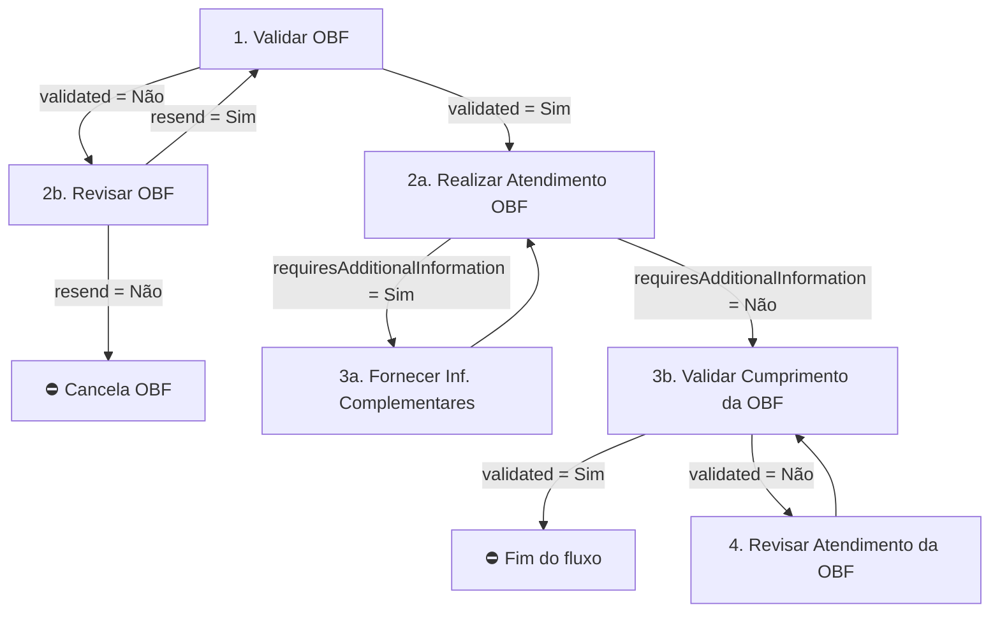

# Fluxo: OBF Default

  

> **Objetivo:** Validar, atender e confirmar o cumprimento de uma Obrigação de Fazer (OBF).

> **Disparado por:** Andamento que gera a tarefa inicial de validação.

> **Resultado final:** OBF cumprida e validada, ou cancelada.

  

---

  

## 🗺️ Visão geral

  

  

---

  

## Etapa 1 — Validar Obrigação de Fazer 🟢

  

| Atributo | Valor |

| -------------------- | ------------------------ |

| **formType** | `validate-obf-default` |

| **mock** | `validate-obf.mock.ts` |

| **Edição de campos** | Não |

| **Origem** | Andamento gerador da OBF |

  

**Descrição:** Analisa se os dados cadastrados no andamento que gerou a tarefa estão corretos.

  

**Decisões:**

  

- ✅ Se `validated` = **Sim** → solicita o time de atendimento e cria **`Ciência nova OBF`** 🔵 + **`Realizar Atendimento OBF`**

- ❌ Se `validated` = **Não** → cria **`Revisar OBF`**

  

> 💡 A tarefa **`Ciência nova OBF`** é apenas de confirmação (ciência).

  

---

  

## Etapa 2a — Revisar OBF 🟢 _(quando `validated` = Não)_

  

| Atributo | Valor |

| -------------------- | --------------------------- |

| **formType** | `review-obf-default` |

| **mock** | `resend-validation.mock.ts` |

| **Edição de campos** | Sim (dados + anexos) |

| **Origem** | Validar Obrigação de Fazer |

  

**Descrição:** Permite alterar dados e adicionar anexos para nova tentativa de validação.

  

**Decisões:**

  

- ✅ Se `resend` = **Sim** → cria **`Validar Obrigação de Fazer`**

- ❌ Se `resend` = **Não** → **cancela a OBF** ⛔ `FIM DO FLUXO`

  

---

  

## Etapa 2b — Realizar Atendimento OBF 🟢 _(quando `validated` = Sim)_

  

| Atributo | Valor |

| -------------------- | -------------------------------- |

| **formType** | `perform-service-obf-default` |

| **mock** | `additional-information.mock.ts` |

| **Edição de campos** | Não |

| **Origem** | Validar Obrigação de Fazer |

  

**Descrição:** Analisa se precisa de informações complementares para realizar o atendimento.

  

**Decisões:**

  

- ✅ Se `requiresAdditionalInformation` = **Sim** → cria **`Fornecer Informações Complementares`**

- ❌ Se `requiresAdditionalInformation` = **Não** → cria **`Validar Cumprimento da OBF`**

  

---

  

## Etapa 3a — Fornecer Informações Complementares 🟢 _(quando `requiresAdditionalInformation` = Sim)_

  

| Atributo | Valor |

| -------------------- | ---------------------------------------- |

| **formType** | `supplement-information-obf-default` |

| **mock** | `provide-additional-information.mock.ts` |

| **Edição de campos** | Sim (dados + anexos) |

| **Origem** | Realizar Atendimento OBF |

  

**Descrição:** Permite alterar dados e adicionar anexos com as informações complementares solicitadas.

  

**Decisões:**

  

- ➡️ Ao concluir → solicita o time de atendimento e cria **`Ciência nova OBF`** 🔵 + **`Realizar Atendimento OBF`**

  

> 💡 A tarefa **`Ciência nova OBF`** é apenas de confirmação (ciência).

  

---

  

## Etapa 3b — Validar Cumprimento da OBF 🟢 _(quando `requiresAdditionalInformation` = Não)_

  

| Atributo | Valor |

| -------------------- | --------------------------------- |

| **formType** | `validate-obf-compliance-default` |

| **mock** | `validated-obligation.mock.ts` |

| **Edição de campos** | Não |

| **Origem** | Realizar Atendimento OBF |

  

**Descrição:** Analisa se a obrigação foi efetivamente cumprida.

  

**Decisões:**

  

- ✅ Se `validated` = **Sim** → ⛔ `FIM DO FLUXO`

- ❌ Se `validated` = **Não** → solicita o time de atendimento e cria **`Revisar Atendimento da OBF`**

  

---

  

## Etapa 4 — Revisar Atendimento da OBF 🟢 _(quando `validated` = Não)_

  

| Atributo | Valor |

| -------------------- | ----------------------------------------------------------- |

| **formType** | `review-obf-service-default` |

| **mock** | `additional-information.mock.ts` |

| **Edição de campos** | Sim (campo _Comentários cumprimento da obrigação_ + anexos) |

| **Origem** | Validar Cumprimento da OBF |

  

**Descrição:** Permite revisar o atendimento prestado antes de uma nova validação de cumprimento.

  

**Decisões:**

  

- ➡️ Ao concluir → cria **`Validar Cumprimento da OBF`**

  

---

  

## 🏁 Fim do fluxo

  

O fluxo encerra quando:

  

- A OBF é **cancelada** na etapa _Revisar OBF_ (`resend = Não`); ou

- A obrigação é **validada como cumprida** na etapa _Validar Cumprimento da OBF_ (`validated = Sim`).

  

---

  

## 📑 Legenda

  

- 🟢 **Tarefa de ação** — exige preenchimento ou decisão do usuário.

- 🔵 **Tarefa de confirmação (ciência)** — apenas confirmação, sem alteração de dados.

- ⛔ **`FIM DO FLUXO`** — ponto de encerramento.

- `formType` — identificador do formulário no front-end.

- `mock` — arquivo de dados simulados usado em testes/desenvolvimento.